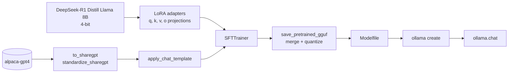

# DeepSeek Finetuning


A single notebook that fine-tunes **DeepSeek-R1 (the distilled Llama 8B variant)** with LoRA adapters and **ends with the model answering through Ollama**. It loads the base model in 4-bit with [Unsloth](https://unsloth.ai/blog/deepseek-r1), trains on an instruction dataset, exports the merged model to GGUF and registers it as a local [Ollama](https://ollama.com) model, all in one run on a free Google Colab T4.

The point of the project is the full path from dataset to a served model, not a new benchmark: the same prompt template is used for training and written into the Ollama `Modelfile`, so the model is prompted at inference exactly as it was trained.

## What was verified

The notebook has **not been executed end to end yet**. Training needs an NVIDIA GPU and the machine it was written on is an Apple Silicon laptop. These are the checks that were actually run.

| Check | Result |
| --- | --- |
| Notebook structure | Valid `nbformat` 4.5 with no warnings, 27 cells. |
| Code cells | Every code cell parses as Python once IPython magics and shell lines are set aside. |
| API surface | The install cell, the `SFTTrainer` and `SFTConfig` arguments and the `to_sharegpt`, `standardize_sharegpt` and `apply_chat_template` calls were compared against the official Unsloth Ollama notebook on 2026-11-09. |
| Training, GGUF export, Ollama chat | **Not run.** No loss curve, timing or sample output is claimed here. |

## How it works



[deepseek_finetuning.ipynb](deepseek_finetuning.ipynb) runs these steps in order:

1. **Install.** Unsloth with the version pins from its official notebooks, plus the `ollama` Python client.
2. **Load.** `unsloth/DeepSeek-R1-Distill-Llama-8B-unsloth-bnb-4bit` in 4-bit, so the 8B model fits in the 16 GB of a T4. The cell stops with a clear message when no CUDA GPU is present.
3. **Add LoRA adapters.** Rank 4 on the four attention projections of all 32 layers. That is 3,407,872 trainable parameters, about 0.04% of the model.
4. **Prepare the data.** `to_sharegpt` merges the `instruction` and optional `input` columns into one user prompt and stitches three rows into one conversation; `standardize_sharegpt` converts it to role and content messages.
5. **Apply the chat template.** An Alpaca-style template with `{INPUT}` and `{OUTPUT}` slots renders each conversation to the `text` field used for training.
6. **Train.** `SFTTrainer` with 8-bit AdamW, a linear schedule and an effective batch size of 8.
7. **Export.** `save_pretrained_gguf` merges the adapters into the base model, converts it with llama.cpp, quantizes it and writes a `Modelfile` derived from the chat template.
8. **Serve.** The notebook installs Ollama, starts the server, creates the model from the `Modelfile` and sends two chat requests to it.

### Default configuration

All of these are set in the configuration cell at the top of the notebook.

| Setting | Default | Variable |
| --- | --- | --- |
| Base model | `unsloth/DeepSeek-R1-Distill-Llama-8B-unsloth-bnb-4bit` | `BASE_MODEL` |
| Dataset | `vicgalle/alpaca-gpt4` (52,002 rows) | `DATASET` |
| Context length | 2,048 tokens | `MAX_SEQ_LENGTH` |
| LoRA rank | 4 | `LORA_RANK` |
| Training steps | 60 | `MAX_STEPS` |
| GGUF quantization | `q4_k_m` (about 5 GB) | `GGUF_QUANTIZATION` |
| Ollama model name | `deepseek_finetuned_model` | `OLLAMA_MODEL_NAME` |

## What makes this project strong for AI Engineer roles

| Skill | Where to look |
| --- | --- |
| **Parameter-efficient fine-tuning.** LoRA adapters on a 4-bit quantized 8B model, sized to train on a free 16 GB GPU. | Section 3 of [deepseek_finetuning.ipynb](deepseek_finetuning.ipynb) |
| **Dataset preparation for chat models.** Column merging with optional fields, multi-turn conversation synthesis and conversion to a standard message format. | Section 4 |
| **Consistent prompt format from training to serving.** One chat template drives both the training text and the generated Ollama `Modelfile`. | Sections 5 and 7 |
| **Model export and quantization.** Adapter merge, GGUF conversion through llama.cpp and a configurable quantization level. | Section 7 |
| **Local model serving.** The fine-tuned model is registered in Ollama and queried through its Python client. | Sections 8 and 9 |

## Quickstart

### Requirements

A Google account for [Colab](https://colab.research.google.com), or any Linux machine with an NVIDIA GPU with 16 GB of memory. The notebook does not run on Apple Silicon.

### Run

1. Upload [deepseek_finetuning.ipynb](deepseek_finetuning.ipynb) to Colab.
2. Select **Runtime > Change runtime type > T4 GPU**.
3. Select **Runtime > Run all**.

The GGUF export downloads and builds llama.cpp and takes several minutes.

### Use the model on your own machine

Download the `.gguf` file and the `Modelfile` from the export directory in Colab and keep them in the same folder. Change the `FROM` line of the `Modelfile` to point at the local `.gguf`, then run:

```bash
ollama create deepseek_finetuned_model -f Modelfile
```

```bash
ollama run deepseek_finetuned_model
```

## Limitations

- **Not executed yet.** See [What was verified](#what-was-verified).
- **The default run is a demo.** 60 steps at an effective batch size of 8 cover 480 conversations, a small fraction of the dataset. Raise `MAX_STEPS` for a real fine-tune.
- **The reasoning format of R1 is not kept.** The Alpaca template has no `<think>` block and the generated `Modelfile` lists `<think>` as a stop token, so the fine-tuned model answers directly.
- **No evaluation.** There is no held-out split and no comparison against the base model.
- **Pinned versions will age.** The install cell pins `transformers` and `trl` to the versions of the official Unsloth notebook on the day it was written.
- **Colab storage is temporary.** The adapters and the GGUF are lost when the session ends unless you download them.

## Troubleshooting

- **`No CUDA GPU found`**: the runtime is on CPU. Change the runtime type to T4 GPU and run all cells again.
- **Install or import errors**: replace the install cell with the current one from the [Unsloth notebooks](https://github.com/unslothai/notebooks).
- **`No Modelfile found`**: the GGUF export failed. Read the output of the export cell; running out of disk space is the usual cause with `q8_0`.
- **`ollama create` cannot connect**: the server was not ready. Run the `ollama serve` cell again and wait a few seconds.
- **Out of memory during training**: lower `per_device_train_batch_size` to 1 or reduce `MAX_SEQ_LENGTH`.

## Credits

Based on the Unsloth guide [Fine-tune DeepSeek-R1 with Unsloth](https://unsloth.ai/blog/deepseek-r1).

## License

[MIT](LICENSE)
